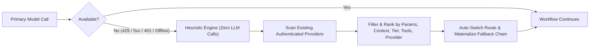

<p align="center">
  
</p>

<h1 align="center">Fallback — Model Switching Heuristics for Hermes</h1>

<p align="center">
  <strong>Dynamic multi-provider model routing, capability heuristics, and zero-LLM-call automatic failover for <a href="https://github.com/NousResearch/hermes-agent">Hermes Agent</a>.</strong>
</p>

<p align="center">
  = 0.19" />
  
  
  
</p>

---

## ⚡ Why This Plugin Exists (Especially for Free-Model Workflows)

When your chosen model goes down, gets deprecated, or hits a quota wall — and your fallback models are either **undefined** or **hardcoded to models that are unavailable too** — your agent is dead in the water.

This plugin is **especially useful if you rely on free models** (across OpenRouter, Google AI Studio, NVIDIA NIM, OpenCode Zen, KiloCode, Nous Portal, Z.AI, etc.):

If you are relying on a free model and you get **rate-limited (`429`)** or hit a provider capacity cap:
1. **Your workflows are blocked** — autonomous loops, subagents, coding sessions, and scheduled jobs grind to an immediate halt.
2. **Switching to another model requires manual work** — you *cannot* ask your agent to pick and switch to another model for you... **because your agent needs a working model just to run!**

### Before vs. After `hermes-fallback`

| Scenario | ❌ BEFORE (Without Fallback Heuristics) | ✅ AFTER (With Fallback Heuristics) |
|---|---|---|
| **Workflow Continuity when Rate-Limited (`429`) or Offline** | **Workflows are blocked.** Long-running tasks, subagents, and cron jobs crash or stall as soon as your free model hits a rate limit or provider outage. | **Your workflows keep going!** Hermes automatically fails over to the next best matching model across your existing providers in real time. |
| **Switching to Another Working Model / Provider** | **Requires manual work.** You can't ask your agent to find and switch to another model *because your agent needs a working model just to run!* You have to stop, browse catalogs, and edit config by hand. | **Happens automatically with zero LLM calls.** The heuristic engine runs even when your model is completely offline — ranking and switching models/providers automatically (or via `/fallback switch`). |
| **Fallback Configuration Maintenance** | **Undefined or brittle hardcoded slugs.** Hardcoded fallback models frequently get deprecated, renamed, or rate-limited on the same provider at the same time. | **Capability-based & cross-provider.** Declare *what* you need (`provider=auto`, `min_context=128k`, `min_params=30b`, `free_only=true`) and let the heuristic resolve live models dynamically. |

> [!IMPORTANT]
> **Fallback Heuristics works even when your primary model is completely offline.**
> All candidate discovery, filtering, ranking, and `config.yaml` synchronization run deterministically in pure Python **without making a single LLM call**. When a model or provider fails, **the model switch happens automatically** across your existing providers — **your workflows keep going without interruption!**

> 📌 **Remember:** You don't need to hardcode fragile model slugs that might disappear next week. Define *what kind of model you need* (e.g., *"largest parameter count across my configured providers with at least 128k context and tool support"*), and **Fallback** resolves the best live candidate automatically.

---

## 🧭 How Automatic Failover Works



1. **Pre-Flight Check (`on_session_start` & `pre_llm_call`)**: Before your agent even makes its first LLM call, the plugin verifies whether your primary provider and model are available and pre-populates `fallback_providers` in `config.yaml` with the top-ranked candidates from your authenticated providers.
2. **Mid-Session Error Recovery (`api_request_error` & `llm_execution`)**: If a model returns `429 Too Many Requests`, `502/503` provider overload, `404` retired model, or `401/402/403` quota/auth errors, the plugin records the unavailable route, excludes it, and dynamically refreshes the fallback chain from your remaining providers.
3. **Cross-Provider Switching**: Unlike single-provider fallbacks, `provider` is a first-class heuristic parameter — seamlessly hopping from e.g. `openrouter` → `gemini` → `nvidia` → `nous` → `ollama` when an entire provider is rate-limited.

---

## 🚀 Installation

Clone this repository into your Hermes plugins directory (`~/.hermes/plugins/model-fallback-heuristic`):

```bash
git clone https://github.com/tomkubik/hermes-fallback.git ~/.hermes/plugins/model-fallback-heuristic
```

Or symlink an existing local checkout:

```bash
ln -s "/path/to/hermes-fallback" ~/.hermes/plugins/model-fallback-heuristic
```

Verify the plugin installation with Hermes:

```bash
hermes plugins validate ~/.hermes/plugins/model-fallback-heuristic
```

---

## 🎁 First-Launch Onboarding: Free-Model Provider Check

On the **first launch of the plugin** (or whenever you run `hermes fallback-heuristic setup` or `/fallback setup`), the plugin automatically scans live/cached provider catalogs (`models.dev`, OpenRouter `/api/v1/models`, Nous Portal `freeRecommendedModels`, and Hermes provider registries) to show **every provider offering free (`$0`) models** and guide you to create API keys with 2–3 providers of your choice.

> [!TIP]
> **Best Practice for Unstoppable Free Workflows:**
> Create free API keys with **at least 2–3 different providers** (for example: **OpenRouter** + **Google AI Studio (Gemini)** + **NVIDIA NIM** or **OpenCode Zen**). That way, if one provider rate-limits your IP or account, Hermes immediately fails over to a different provider's free tier and your workflow never stops!

### Running the First-Launch Setup

```bash
# Launch interactive setup (scans free providers, lets you pick by number/name, and saves keys to ~/.hermes/.env)
hermes fallback-heuristic setup

# Or choose your preferred fallback providers directly
hermes fallback-heuristic setup openrouter,gemini,nvidia

# Re-run the live free-model provider check anytime
hermes fallback-heuristic free-providers
```

> 📌 **Remember:** In an active Hermes chat session, you can also run `/fallback setup` or `/fallback setup openrouter,gemini,nvidia` — it executes locally without needing an LLM response!

---

## 🎛️ Heuristic Parameters & Ranking Strategies

You can combine any of the following parameters to control how replacement models are filtered and ranked:

| Parameter | Type / Values | Description |
|---|---|---|
| `provider` | `auto` / `existing` / `<id>` | Target a single provider or `"auto"` / `"existing"` to search across all authenticated providers. |
| `providers` | `list[str]` | Ordered preference list of providers to search (e.g. `["openrouter", "gemini", "nvidia", "anthropic"]`). |
| `exclude_providers` | `list[str]` | Providers to exclude from candidate resolution. |
| `allow_provider_switch` | `bool` (default `true`) | Allow switching to a different authenticated provider when your primary model/provider fails. |
| `prefer_current_provider` | `bool` (default `false`) | Try candidates on your currently active provider before switching to another provider. |
| `sort_by` | `str` | Primary ranking strategy (see table below). |
| `min_context` / `max_context` | `int` or `"128k"`, `"1m"` | Minimum / maximum context window length in tokens. |
| `min_params` / `max_params` | `float` or `"30b"`, `"70b"` | Minimum / maximum model parameter size in billions (`B`). |
| `free_only` | `bool` (default `false`) | Restrict candidate selection strictly to free (`$0` / `:free`) models. |
| `require_tools` | `bool` (default `true`) | Require tool/function-calling support so agent workflows don't break. |
| `flash_only` | `bool` (default `false`) | Restrict to fast/flash/mini/haiku/turbo tier models. |
| `vendor` | `str` | Filter by model creator/family (`anthropic`, `google`, `qwen`, `deepseek`, `meta-llama`, `nvidia`). |
| `name_filter` | `str` | Substring or glob filter on model ID/name (e.g. `coder`, `*flash*`). |
| `reasoning_effort` | `str` | Reasoning effort for fallback models (`none`, `minimal`, `low`, `medium`, `high`, `xhigh`, `default`). |
| `max_candidates` | `int` (default `3`) | Number of concrete fallback candidates materialized per heuristic rule. |

### Supported `sort_by` Strategies

- **`largest_parameter_count`** *(default)*: Ranks models with the highest parameter count (`B`) first, breaking ties by context window and release date.
- **`greatest_context`**: Ranks models with the largest context window (e.g. `1M`–`2M` tokens) first.
- **`latest`**: Ranks the most recently released models first using catalog timestamps and date snapshots.
- **`latest_flash`**: Filters to fast/flash-tier models and ranks the newest ones first.
- **`smallest`**: Ranks the smallest, fastest models first (while still honoring `min_params` / `min_context`).
- **`provider_preference`**: Ranks strictly in the order of your `providers` list, then by parameter size and context window within each provider.

> [!NOTE]
> **Tool Support Safety (`require_tools: true`):**
> By default, `require_tools` is enabled so Hermes never falls back to a chat-only model that cannot execute tool calls during an agentic workflow.

---

## 🛠️ Zero-LLM-Call Usage (Works When Your Model Is Offline)

Because you can't use an LLM to fix an offline LLM, every command in this plugin runs **100% locally without a model call**.

### 1. Terminal CLI (`hermes fallback-heuristic` or `hermes fallback`)

```bash
# View current primary model, heuristic settings, available providers, and fallback chain
hermes fallback-heuristic status

# First-launch free provider wizard & live catalog check
hermes fallback-heuristic setup
hermes fallback-heuristic free-providers

# List all configured/authenticated providers (or pass --all to see all 25+ supported providers)
hermes fallback-heuristic providers --all

# Preview ranked candidate models across all your existing providers
hermes fallback-heuristic resolve --provider auto --min-params 30B --min-context 128k --sort-by largest_parameter_count

# Preview only FREE models across OpenRouter, Gemini, and NVIDIA
hermes fallback-heuristic resolve --providers openrouter,gemini,nvidia --free-only --sort-by greatest_context

# Immediately switch your active model & provider in config.yaml to the best available match
hermes fallback-heuristic switch --provider auto --min-context 128k --sort-by largest_parameter_count

# Configure persistent heuristic settings and auto-sync fallback_providers in config.yaml
hermes fallback-heuristic set provider=auto providers=openrouter,gemini,nvidia min_context=128k free_only=true sort_by=largest_parameter_count

# Re-materialize fallback_providers in config.yaml on demand
hermes fallback-heuristic sync
```

### 2. In-Session Slash Commands (`/fallback` or `/fallback-heuristic`)

Slash commands are intercepted locally by Hermes before any LLM call is made:

```text
/fallback status
/fallback setup
/fallback setup openrouter,gemini,nvidia
/fallback free-providers
/fallback providers
/fallback set provider=existing sort_by=largest_parameter_count min_context=128k free_only=true
/fallback resolve provider=openrouter,gemini,nvidia sort_by=greatest_context
/fallback switch provider=existing sort_by=latest_flash
/fallback sync
/fallback on
/fallback off
```

> 📌 **Remember:** If your session gets stuck mid-conversation because your primary model just went offline or hit a rate limit, type `/fallback switch` right in the chat prompt — it will switch your active provider and model immediately without needing the dead model to respond!

### 3. Declarative `config.yaml` Configuration

You can configure plugin settings under `plugins.entries.model-fallback-heuristic.settings`:

```yaml
fallback_heuristics: true

plugins:
  enabled:
    - model-fallback-heuristic
  entries:
    model-fallback-heuristic:
      enabled: true
      settings:
        enabled: true
        provider: auto
        providers:
          - openrouter
          - gemini
          - nvidia
          - opencode-zen
          - nous
        exclude_providers: []
        allow_provider_switch: true
        prefer_current_provider: false
        sort_by: largest_parameter_count
        min_context: 128000
        min_params: 30
        free_only: true
        require_tools: true
        flash_only: false
        reasoning_effort: default
        max_candidates: 3
        auto_sync_config: true
        auto_switch_primary_when_unavailable: true
```

Or declare multi-rule heuristic chains directly inside `fallback_providers`:

```yaml
fallback_heuristics: true

fallback_providers:
  # Tier 1: Largest free model with >=128k context across OpenRouter, Gemini, or NVIDIA
  - provider: existing
    providers: [openrouter, gemini, nvidia]
    criteria:
      sort_by: largest_parameter_count
      min_context: 128k
      min_params: 30b
      free_only: true
      allow_provider_switch: true
      require_tools: true

  # Tier 2: Fastest free Flash model on OpenRouter or OpenCode Zen
  - provider: existing
    providers: [openrouter, opencode-zen, kilocode]
    heuristic: latest_flash_free

  # Tier 3: Any available model across any configured provider (including local Ollama)
  - provider: existing
    criteria:
      sort_by: greatest_context
      allow_provider_switch: true
```

> [!WARNING]
> **Static vs. Heuristic Fallbacks:**
> If you also have manual static entries in `fallback_providers` (e.g. `{provider: openai, model: gpt-4o-mini}`), the plugin preserves them intact alongside its managed heuristic entries. Running `hermes fallback-heuristic clear` or `/fallback clear` only removes heuristic rules unless you explicitly clear all entries.

---

## 📊 Live Catalog Check: Providers Offering Free Models / Free Tiers

| # | Provider (`id`) | Free Models Available | Sample Free Models | Env Var | Get a Free API Key |
|---|---|---|---|---|---|
| **1** | **OpenRouter** (`openrouter`) ★ | **60+ `:free` models** | `nvidia/nemotron-3-super-120b-a12b:free`, `minimax/minimax-m3.1-flash:free`, `qwen/qwen3-coder:free`, `deepseek/deepseek-r1:free`, `meta-llama/llama-3.3-70b-instruct:free` | `OPENROUTER_API_KEY` | [openrouter.ai/keys](https://openrouter.ai/keys) |
| **2** | **Google AI Studio / Gemini** (`gemini`) ★ | **Free API tier (18+ models)** | `gemini-2.5-flash`, `gemini-2.5-pro`, `gemini-3.7-flash`, `gemini-flash-lite-latest` | `GEMINI_API_KEY` | [aistudio.google.com/apikey](https://aistudio.google.com/apikey) |
| **3** | **NVIDIA NIM** (`nvidia`) ★ | **100+ `$0` dev models** | `nvidia/llama-3.3-70b-instruct`, `nvidia/llama-3.1-nemotron-70b-instruct`, `mistralai/mistral-nemotron` | `NVIDIA_API_KEY` | [build.nvidia.com](https://build.nvidia.com) |
| **4** | **OpenCode Zen** (`opencode-zen`) ★ | **45 `-free` models** | `nemotron-3-ultra-free`, `nemotron-3-super-free`, `nemotron-3.5-super-vl-free`, `ling-3.0-flash-fin-free` | `OPENCODE_ZEN_API_KEY` | [opencode.ai/zen](https://opencode.ai/zen) |
| **5** | **Kilo Code Gateway** (`kilocode`) ★ | **24 `:free` models** | `minimax/minimax-m3.1-flash:free`, `cohere/north-mini-code:free`, `xingchen-agi/xing4.0-29b-a4b:free`, `openrouter/free` | `KILOCODE_API_KEY` | [kilocode.ai](https://kilocode.ai) |
| **6** | **Nous Research Portal** (`nous`) ★ | **6–8 `:free` models** | `stepfun/step-3.7-flash:free`, `poolside/laguna-s-2.1:free`, `upstage/solar-mini4:free`, `meituan/longcat-2.5-preview:free` | `NOUS_API_KEY` | [portal.nousresearch.com](https://portal.nousresearch.com) |
| **7** | **Vercel AI Gateway** (`ai-gateway`) | **9 `$0` models** | `meta/llama-3.3-70b`, `meta/llama-4-maverick`, `meta/llama-4-scout`, `minimax/minimax-m3.1-flash` | `AI_GATEWAY_API_KEY` | [vercel.com/ai-gateway](https://vercel.com/ai-gateway) |
| **8** | **Z.AI / Zhipu GLM** (`zai`) | **3 permanently `$0` Flash models** | `glm-4.7-flash`, `glm-4.6v-flash`, `glm-4.5-flash` | `GLM_API_KEY` / `ZAI_API_KEY` | [chat.z.ai](https://chat.z.ai) |
| **9** | **Hugging Face Inference** (`huggingface`) | **Free serverless tier** | `zai-org/GLM-4.7-Flash`, `Qwen/Qwen3.5-72B-Instruct`, `deepseek-ai/DeepSeek-V3.2` | `HF_TOKEN` | [huggingface.co/settings/tokens](https://huggingface.co/settings/tokens) |
| **10** | **OpenCode Go** (`opencode-go`) | **5 `-free` models** | `minimax-m3.1-flash-free`, `step-5-preview-free`, `longcat-2.5-preview-free`, `beam-free` | `OPENCODE_GO_API_KEY` | [opencode.ai](https://opencode.ai) |
| **11** | **Alibaba DashScope / Qwen** (`alibaba`) | **4 `$0` models + free quota** | `qwen3.8-flash`, `qwen3.6-flash`, `deepseek-r1-distill-llama-8b` | `DASHSCOPE_API_KEY` | [modelstudio.console.alibabacloud.com](https://modelstudio.console.alibabacloud.com) |
| **12** | **Tencent TokenHub** (`tencent-tokenhub`) | **2 `$0` models** | `hy3-preview`, `hy3` | `TENCENT_TOKENHUB_API_KEY` | [tokenhub.tencentmaas.com](https://tokenhub.tencentmaas.com) |
| **13** | **CommandCode** (`commandcode`) | **1 `:free` model** | `inclusionai/ling-3.1-flash:free` | `COMMANDCODE_API_KEY` | [commandcode.ai](https://commandcode.ai) |
| **14** | **Novita AI** (`novita`) | **1 `$0` model** | `apodex/apodex-1.1-mini` | `NOVITA_API_KEY` | [novita.ai/settings/key-management](https://novita.ai/settings/key-management) |
| **15** | **GroqCloud** (`groq`) | **Free dev tier + `$0` model** | `allam-2-7b`, `llama-3.3-70b-versatile` | `GROQ_API_KEY` | [console.groq.com/keys](https://console.groq.com/keys) |
| **16** | **Mistral AI** (`mistral`) | **Free Experiment tier + 2 `$0` Labs** | `labs-devstral-small-2512`, `labs-leanstral-1-5-1` | `MISTRAL_API_KEY` | [console.mistral.ai/api-keys](https://console.mistral.ai/api-keys) |
| **17** | **Cohere** (`cohere`) | **Free Trial key + 2 `$0` models** | `north-mini-code-1-0`, `north-small-translate-09-2026` | `COHERE_API_KEY` | [dashboard.cohere.com/api-keys](https://dashboard.cohere.com/api-keys) |
| **18** | **Ollama / LM Studio / vLLM** (`ollama`) | **100% free local inference** | `qwen3-coder:30b`, `llama3.3:70b`, `gpt-oss:20b` | *(none required)* | [ollama.com](https://ollama.com) |

---

## 🔌 All Supported Model Providers

**Fallback** works with all canonical Hermes providers as well as custom OpenAI-compatible endpoints:

| Provider ID | Accepted Aliases | Credential / Discovery Source |
|---|---|---|
| `openrouter` | `or`, `open-router` | `OPENROUTER_API_KEY` / auth store / config |
| `gemini` | `google`, `google-gemini`, `vertex` | `GEMINI_API_KEY` / `GOOGLE_API_KEY` |
| `nvidia` | `nim`, `nvidia-nim` | `NVIDIA_API_KEY` |
| `opencode-zen` | `zen` | `OPENCODE_ZEN_API_KEY` / `OPENCODE_API_KEY` |
| `kilocode` | `kilo` | `KILOCODE_API_KEY` |
| `nous` | `nous-portal`, `nousresearch` | `NOUS_API_KEY` / `hermes login` OAuth (`auth.json`) |
| `anthropic` | `claude` | `ANTHROPIC_API_KEY` / `CLAUDE_CODE_OAUTH_TOKEN` |
| `openai` | — | `OPENAI_API_KEY` |
| `openai-codex` | `codex` | `OPENAI_API_KEY` / Codex OAuth |
| `deepseek` | — | `DEEPSEEK_API_KEY` |
| `zai` | `z-ai`, `glm`, `zhipu` | `GLM_API_KEY` / `ZAI_API_KEY` / `Z_AI_API_KEY` |
| `kimi-coding` | `kimi`, `moonshot`, `kimi-cn` | `KIMI_API_KEY` / `MOONSHOT_API_KEY` |
| `minimax` | `minimax-cn` | `MINIMAX_API_KEY` |
| `xai` | `grok`, `x-ai` | `XAI_API_KEY` |
| `huggingface` | `hf` | `HF_TOKEN` / `HUGGINGFACE_API_KEY` |
| `ai-gateway` | `vercel`, `vercel-ai-gateway` | `AI_GATEWAY_API_KEY` |
| `opencode-go` | `opencode` | `OPENCODE_GO_API_KEY` |
| `alibaba` | `dashscope`, `qwen-portal`, `qwen-oauth` | `DASHSCOPE_API_KEY` / Qwen OAuth |
| `copilot` | `github-copilot`, `copilot-acp` | `GH_TOKEN` / `GITHUB_TOKEN` / OAuth |
| `xiaomi` | `mimo` | `XIAOMI_API_KEY` / `MIMO_API_KEY` |
| `bedrock` | `aws-bedrock` | `AWS_ACCESS_KEY_ID` / `AWS_BEARER_TOKEN_BEDROCK` |
| `ollama` / `lmstudio` / `vllm` | `local` | Local endpoint or configured `base_url` |
| `custom:<name>` | `custom` | Any entry in `custom_providers` in `config.yaml` |

---

## 🤖 Agent Tools & Lifecycle Hooks Reference

When an LLM is active, the plugin also exposes 4 native tools so the agent can inspect or adjust routing on your behalf:

- `fallback_heuristic_resolve` — Preview and rank candidate models across any or all providers using heuristic filters.
- `fallback_heuristic_switch` — Switch the active model and/or provider to the top heuristic match.
- `fallback_heuristic_configure` — View or update persistent heuristic rules and settings in `config.yaml`.
- `fallback_heuristic_providers` — List all authenticated providers and run the live free-model provider check.

---

## 🧪 Running Tests

```bash
pytest tests/test_plugin.py -v
```

---

## 📄 License

Released under the [MIT License](LICENSE).
